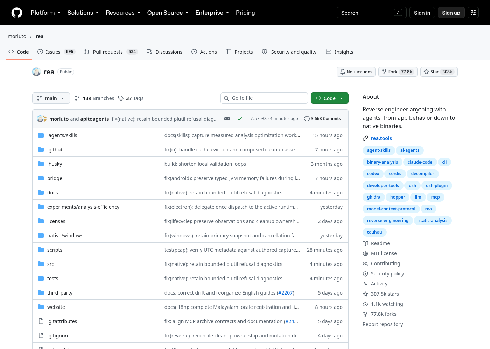
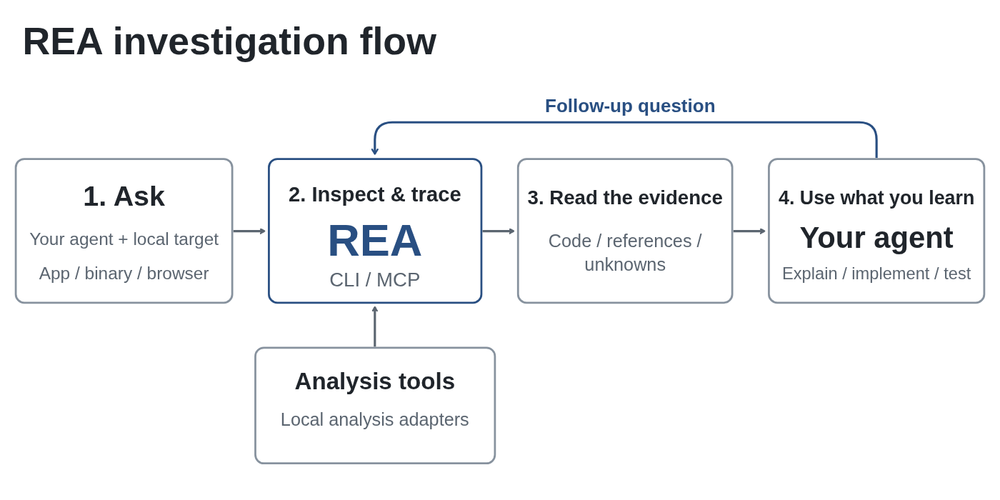
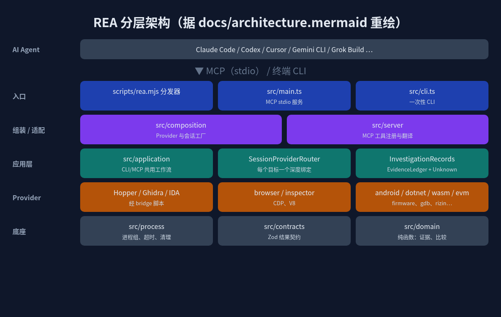
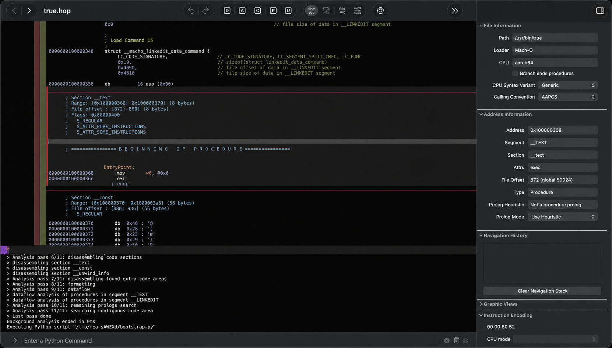

> 在线阅读（GitHub Pages）：https://maynor996.github.io/rea-reverse-agent/

# 半年 30 万 Star！ReA 让 AI Agent 学会逆向：从 App 行为一路挖到二进制

> 数据截至 2026-10-18（北京时间）：GitHub 上 morluto/rea 约 30.75 万 Star、7.78 万 Fork，仓库 2026 年 4 月 14 日才创建，最新版本 rea-agents v6.5.0（2026-10-13）。

<!-- 图片上传失败，暂用本地路径，发布前需替换 -->


## 一、ReA 是什么？

一句话：**ReA（官方写作 REA，Reverse Engineer Anything）是一个给 AI Agent 用的逆向工程 MCP 服务器**，顺带也能当命令行工具用。

README 的定位很直白：“One MCP for reverse engineering across binaries, applications, and runtime behavior.” 你在别人的 App 里看到一个好用的功能，想知道它怎么实现的，就让 Claude Code、Codex、Cursor 这类 Agent 调用 REA 去“拆”这个 App：不需要源码，它会给出伪代码、汇编、模块关系等**证据**，Agent 再据此解释原理，甚至帮你在自己项目里实现一个类似的。

项目基础信息：

| 项 | 内容 |
|---|---|
| 仓库 | github.com/morluto/rea |
| 语言 | TypeScript（桥接部分有 Java / Python / Swift） |
| 协议 | MIT（第三方组件各自保留许可） |
| npm 包 | rea-agents，命令 `rea` |
| Node 要求 | 22.x（≥22.19）、24.x（≥24.11）或 26+ |

## 二、为什么这么火？

我觉得有三点：

1. **踩中了 “Agent + MCP” 的风口**。过去逆向是 IDA / Ghidra 老师傅的手艺活，现在 Agent 会写代码了，缺的是“眼睛”。REA 把一堆专业逆向工具包装成 Agent 能调用的工具，等于给 Agent 装上了逆向能力。
2. **覆盖面离谱地广**。不只是原生二进制，JS/Electron 应用、.NET 程序集、Android APK、网站、固件、WASM、EVM 字节码、SQLite、抓包文件、Linux 崩溃转储……README 里的支持表有二十多行。
3. **迭代极快、工程量扎实**。光 10 月 9 日到 14 日就发了 v6.1 到 v6.5 五个版本；仓库截图里能看到 3600+ 次提交、139 个分支；`.github/workflows` 下有几十条 `real-*` 开头的真实工具验证流水线（真 Ghidra、真 Hopper、真浏览器等）。截至今天 issue 区仍在不停有人提 Bug，社区相当活跃。

## 三、它解决什么问题？

传统做法：开 Ghidra → 找函数 → 看伪代码 → 手动重命名 → 自己总结。大模型能帮忙，但你得把一大坨反编译结果复制给它，它还容易“编故事”。

REA 的思路是让 Agent **自己去调工具、自己追调用链**，而且每个结论都附带证据和“未知项”。README 原话：results include the evidence and limitations behind each conclusion。架构里专门有 `EvidenceLedger`（证据账本）和 `Unknown` 的概念——这对抑制模型幻觉很关键：说不清的地方明确标为未知，而不是瞎猜。

另外，**分析在本地跑**。FAQ 里说得很清楚：REA 本地分析目标，Agent 只拿到工具结果；但你用的模型服务商怎么处理这些结果，要看它自己的数据政策。

## 四、工作流程



上图来自官方 README，流程是：

1. 你向 Agent 提问（比如“Notes 里的搜索是怎么做的”）；
2. Agent 通过 MCP 调用 REA，检查目标、追踪相关代码；
3. REA 返回代码、引用关系和未知项；
4. Agent 基于证据继续追问、解释，或者写代码并测试。

CLI 命令走的是同一套工作流，所以脚本化也很方便。

## 五、架构拆解

我按仓库里的 `docs/architecture.mermaid` 重画了一张简化图：



从上到下几层：

- **入口层**：`scripts/rea.mjs` 是可执行分发器，把请求路由到 `src/main.ts`（MCP stdio 服务）或 `src/cli.ts`（一次性 CLI）。`package.json` 里 `rea` 和 `rea-agents` 两个命令都指向它。
- **组装 / 适配层**：`src/composition` 负责创建各类 Provider 与会话工厂；`src/server` 负责 MCP 工具注册和请求翻译。
- **应用层**：`src/application` 是 CLI 与 MCP 共用的工作流。其中 `SessionProviderRouter + BinarySession` 实现“每个目标一个不可变的深度分析绑定”；`AnalysisProviderRegistry` 的注释写着“deterministic selection, no fallback”——选哪个反编译后端是确定的，不会悄悄换一个，这样结果可复现。
- **Provider 层**：Hopper、Ghidra、IDA 是原生分析的“深度后端”；另外还有浏览器（CDP/Playwright）、V8 Inspector、.NET、Android（JADX）、固件（Binwalk/Unblob）、GDB、Rizin、objdump、WASM、EVM 等一大堆。IDA 部分是对外部 `ida-pro-mcp` 的契约适配。
- **底座**：`src/process` 管进程组、超时和清理；`src/contracts` 定义调用方可见的结果 schema；`src/domain` 是无副作用的纯函数模块（证据、比较、应用图）。

## 六、关键代码走读

**1. 桥接脚本：在逆向工具“内部”干活**

`bridge/` 目录是 REA 和各大工具的连接点：

- `bridge/hopper_bridge.py`：跑在 Hopper 内部，把操作适配到 Hopper 的 Python API；外层 `src/hopper/` 通过 Unix socket 协议和它通信。
- `bridge/ghidra/ReaGhidraBridge.java`：打包成 Ghidra HeadlessScript，提供函数清单、反编译、引用、CFG。同目录还有 MIPS、DOS 等专项处理脚本。
- `bridge/android/ReaJadxBridge.java`、`bridge/cutter/rea_bridge.py`、`bridge/pwndbg/`、`bridge/mitmproxy/capture.py` 等分别对接 JADX、Cutter、pwndbg、mitmproxy。

这种“插件跑在宿主工具里 + 外部 TypeScript 进程管理生命周期”的设计，好处是能直接用这些工具成熟的分析能力，而不是自己造一个反编译器。

**2. 会话与证据**

`src/application/investigation/` 负责组合 `InvestigationRecords`，把证据账本和未知项的归属管起来；`AnalysisSnapshotCache` 做二进制目标的快照缓存。v6.5.0 的更新日志也提到可以“分页读取已保存的证据，无需重跑分析”，以及“分析或清理失败时，已完成的证据和部分观测依然保留”。

**3. Agent Skill**

仓库 `.agents/skills/reverse-engineer-anything/` 下是给 Agent 的调查指引，按 Android、JS 应用、原生产物、运行时观测等拆成多份参考文档。`setup` 时会把 MCP 注册和这套指引一起装进你的 Agent。

## 七、快速上手

以下命令都来自官方 README。

**1）给 Agent 安装（推荐）**

```bash
npx rea-agents setup
```

选择你的 Agent，确认改动（会备份原配置），然后重启 Agent。支持 Claude Code、Codex、Cursor、Gemini CLI、Grok Build 等。

**2）直接对 Agent 说**

```text
Understand how search works in the Notes app, show me the evidence, and build a
similar feature for my project.
```

把 Notes 换成你的目标 App 和功能即可。

**3）终端分析 JS/Electron 应用**

```bash
npx -y rea-agents@latest analyze-javascript-application /absolute/path/to/app --json
```

输出包括模块、导入关系、Electron 边界及其证据。

**4）全局安装与更新**

```bash
npm install --global rea-agents
rea --help
rea update
```

注意几点：

- 原生二进制深度分析需要 Hopper、Ghidra 或 IDA 之一；静态 JS 和 .NET 分析不需要。
- Linux 上跑 Ghidra、JADX、固件工具和静态 JS/Electron 分析，需要 PATH 里有 procps 兼容的 `ps`。
- 大型二进制可通过 `REA_GHIDRA_STARTUP_TIMEOUT_MS` / `REA_HOPPER_STARTUP_TIMEOUT_MS` 调大启动超时。



## 八、官方案例


- **DX-Ball**：追一个声音调用到“位置→声像”辅助函数，把不完整的伪代码还原成 C。README 写道：重建版本通过了 3,205 个原始 x86 用例，并复现了全部 63 个编译后的函数字节。
- **Notion**：从渲染进程的剪贴板 API，经 preload 和 IPC 一路追到主进程，查看富文本剪贴板格式。
- **TH04（东方幻想乡，PC-98）**：分析 16 位指令，还原固定/瞄准弹幕环的角度计算，并和历史编译器输出对比。

## 九、和同类项目比

| 维度 | REA | 单工具 MCP（如 ida-pro-mcp） | 直接用 Ghidra / IDA |
|---|---|---|---|
| 覆盖范围 | 原生、JS/Electron、.NET、Android、网站、固件等 | 主要围绕单个工具 | 原生二进制为主 |
| 后端 | 可选 Hopper / Ghidra / IDA 等 | 绑定一个 | 自身 |
| 面向 Agent | 是，带 Skill 与证据/未知项契约 | 是 | 否，需人工操作 |

需要说明：REA 的 IDA 支持本身就是适配上游 `ida-pro-mcp`，二者是组合关系而非替代。表里只列了结构性差异，没有性能对比——我没找到可信的横向基准数据。

## 十、局限与注意

- **依赖外部工具**：深度原生分析离不开 Hopper/Ghidra/IDA；商业工具（IDA Pro、Hopper、JEB）必须合法授权，README 明确反对破解版和共享密钥。
- **平台差异大**：很多能力标注了“仅 Linux x64 验证”或需要特定版本工具，Windows 下 Ghidra 支持还是实验性的。
- **变化快**：官方自己都说“REA changes quickly”，遇到问题先 `rea update`。这也意味着文档和行为可能随版本变化。
- **合规红线**：DISCLAIMER 明确不支持绕过 DRM / 授权校验 / 反作弊、开发外挂、复制专有代码等用途。逆向在不同司法辖区和软件许可下可能受限，务必只分析自己拥有或获授权的软件。
- **模型数据**：分析虽在本地，但结果会发给你的模型服务商。

## 十一、适合谁用？

- 安全研究、恶意样本分析、CTF 选手；
- 想搞懂某个 Electron / Web 应用功能实现的前端、全栈开发者；
- 做互操作、老软件/老游戏保存与重建的人；
- 想让 Agent 帮忙排查自家二进制、崩溃转储的工程师。

## 十二、总结

REA 的本质，是把散落在 IDA、Ghidra、Hopper、JADX、浏览器调试协议里的逆向能力，用 MCP 统一成 Agent 可调用、结果可追溯的工具集。它最值得借鉴的不只是“能逆向”，而是“每个结论都有证据、不确定就写未知”的设计。半年 30 万 Star，说明“Agent 看懂没有源码的软件”这件事，大家是真的需要。

顺带一提，这篇文章的资料检索和整理，我也是用 Grok Bot 月卡这类 AI 工具辅助完成的（https://momoai.czvip.cn），效率确实高不少。

**参考**：GitHub morluto/rea 的 README、CHANGELOG、DISCLAIMER、docs/architecture.mermaid；官网 rea.tools。